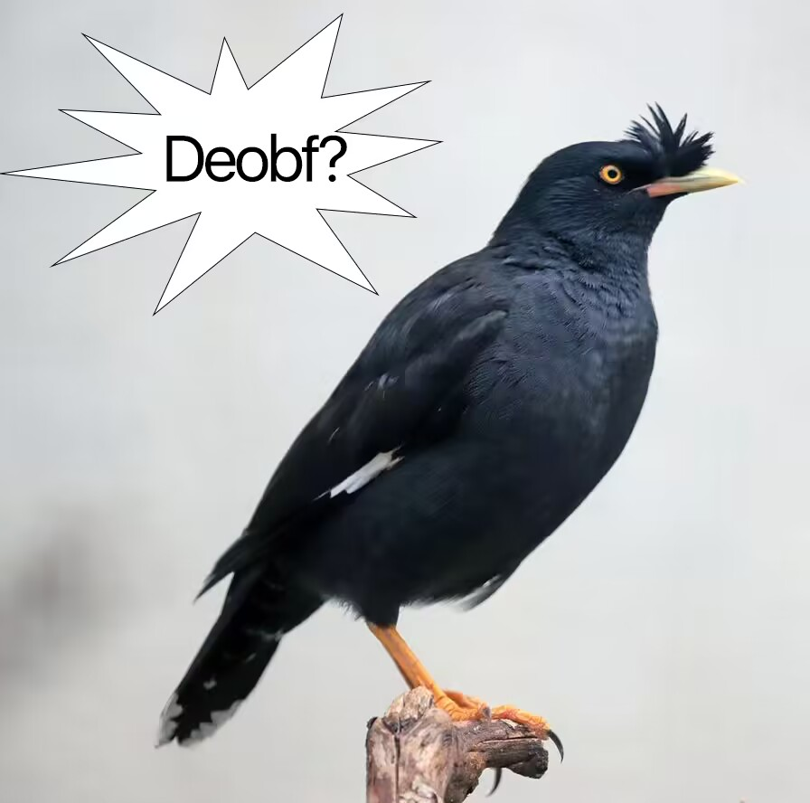
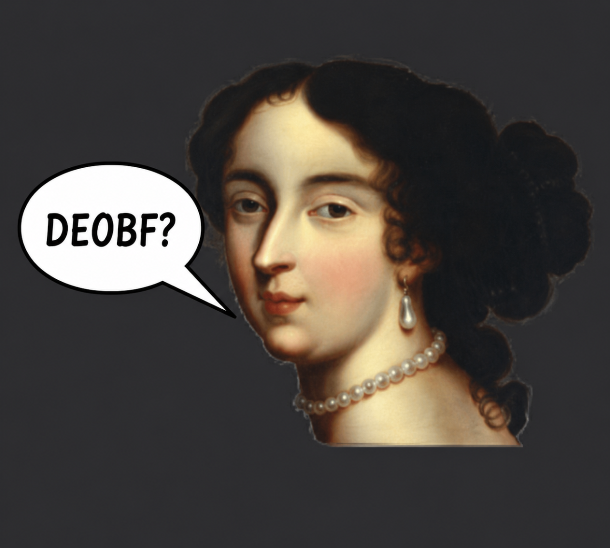

<h1 align="center">Vulcan Open Source</h1>

From version 2.9.7.28
---
Please fork and download this before a DMCA takedown!

<p align="center">
  &nbsp;&nbsp;
</p>

This source is only for educational and research purposes, we are NOT afiliated with Vulcan AntiCheat, all credits to frap and other Vulcan devs for making this wonderful AntiCheat.

## Build

```
./gradlew build
```
